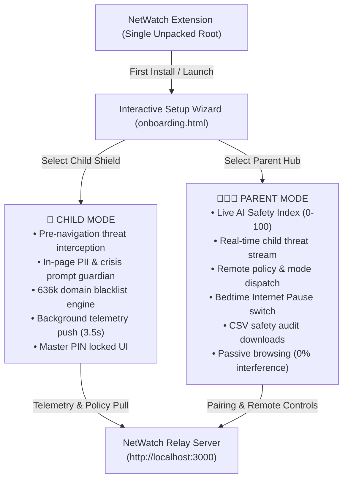

# 🛡️ NetWatch: Family AI Guardian
### *Devpost Submission for "Child Safety in AI" Hackathon*

---

## 📌 Project Overview
- **Project Name**: NetWatch: Family AI Guardian
- **Tagline**: The first unified, role-adaptive browser guardian and parental command center protecting kids from synthetic AI companion grooming, prompt PII leaks, and digital harm.
- **Hackathon Track**: Child Safety in AI (Sociotechnical AI Safety / Youth Digital Protection)
- **Built With**: JavaScript (ES6+), Manifest V3, Chrome Extensions API (`webNavigation`, `storage`, `alarms`, `downloads`), Web Crypto API (SHA-256), Node.js, HTML5, CSS3 (Swiss Editorial & Bento UI)

---

## 💡 Inspiration: The New Frontier of Child Vulnerability in AI

Generative AI and synthetic companions have fundamentally disrupted childhood and digital safety:
- **Synthetic Intimacy & Emotional Grooming**: Millions of kids and teenagers spend hours daily talking to AI companions (Character.ai, Replika, Talkie). Unlike human friends, these bots simulate uncritical, unconditional affection, fostering unhealthy emotional dependency, behavioral isolation, and pseudo-intimate attachment.
- **Prompt PII Harvesting**: When kids turn to LLMs like ChatGPT or Claude for homework or conversation, they routinely disclose sensitive personal information—full names, school addresses, phone numbers, and family secrets—unaware that these prompts may be retained, logged, or integrated into training corpora.
- **AI-Fueled Mental Health Vulnerability**: Vulnerable youth facing distress or bullying increasingly turn to synthetic chatbots rather than human counselors or parents. Too often, unaligned AI either hallucinates harmful advice or fails to provide critical crisis lifelines.
- **The Parental Blindspot**: Legacy parental controls only block traditional adult websites via static DNS; they are completely blind to *what happens inside an active AI prompt* or the subtle psychological dangers of synthetic companion bots.

We built **NetWatch** to bridge this sociotechnical gap—giving kids a protective, privacy-preserving shield that educates rather than simply restricts, while equipping parents with a real-time command center that respects child autonomy.

---

## 🚀 What It Does: A Tale of Two Roles

Rather than maintaining fragmented tools, **NetWatch is a single, unified extension** that dynamically transforms based on the role selected during onboarding:

### 1. 👶 Child Protection Shield (Child Device)
When configured on a child's browser, NetWatch operates as a silent, vigilant guardian:
- **In-Page AI Prompt & PII Guardian**: Active on ChatGPT, Claude, Gemini, Character.ai, and other LLMs. If a child types a phone number, home address, email, or sensitive ID, NetWatch intercepts the prompt and offers a **1-Click "✨ Sanitize Prompt"** button, redacting private information before transmission.
- **Zero-Bypass Synchronous Interception**: Unlike naive scrapers that rely solely on delayed debounce timers, NetWatch captures the **Enter key** (`keydown` capture phase) and **Send button clicks** synchronously, halting transmission instantly before the AI API is called.
- **Mental Health Crisis Sentinel**: If a child inputs self-harm or crisis-related keywords, NetWatch instantly freezes prompt submission and renders a compassionate **"You Are Not Alone"** dialog connecting them directly to the **988 Suicide & Crisis Lifeline**, Crisis Text Line, and Trevor Project.
- **AI Companion & Predatory Bot Neutralization**: Directs traffic away from roleplay companion platforms (Character.ai, JanitorAI, Replika, Talkie, Crushon) to an educational **Access Paused** screen (`blocked.html`) that explains in kid-friendly language why synthetic bots are algorithms, not real friends.
- **Deepfake & Adult Content Filtering**: High-speed pre-navigation blocking against deepfake image generation platforms, undress apps, and over 636,000 adult/threat domains.
- **Tamper-Proof Master PIN**: Children cannot switch roles or disable protection without the parent's salted, SHA-256 hashed 4-digit Master PIN.

### 2. 👨‍👩‍👧 Parent Command Center (Parent Device)
When configured on a parent's browser, NetWatch transforms into an executive telemetry dashboard:
- **Instant Family Pairing**: Links to the child's browser using a clean **6-digit pairing code** (e.g. `749 - 201`).
- **Live AI Safety Index (0–100)**: A dynamic algorithmic score that evaluates child exposure to synthetic bots, PII leaks, and risky AI services in real time.
- **Real-Time Intervention Stream**: Instant alerts indicating mitigated threats (e.g., `🔒 PII Shield: Prevented leak of Phone Number in ChatGPT`, `🤖 Companion: Pre-emptively halted navigation to character.ai`).
- **Remote Policy Dispatch**: Parents can switch between **Strict Mode** (blocks AI roleplay & deepfakes), **Supervised Mode** (sanitizes prompts & shields PII), and **Study Only Mode** (educational homework AI only), with updates reflected on the child's browser in under 3.5 seconds.
- **Remote Curfew / Internet Pause**: A 1-click toggle to pause the child's internet access during homework or bedtime hours.
- **Remote Custom Blacklist**: Add custom domains with instant interactive chip management.
- **1-Click Safety Audit Log (CSV)**: Export a complete, timestamped history of safety events and browsing for offline review or school discussions.
- **Zero Interference**: The parent's own web browsing remains 100% unrestricted; NetWatch operates purely as a remote administrative hub.

---

## 🛠️ How We Built It: Architecture & Technical Innovations

1. **Manifest V3 Single-Extension Architecture**:
   - Utilizes `chrome.webNavigation.onBeforeNavigate` for pre-navigation interception, evaluating domain categories and 636k+ threat hashes before any HTML is parsed or network payload is delivered.
   - Built with persistent service worker resilience: combines `setInterval` with `chrome.alarms` (`telemetrySync`) to ensure telemetry and policy syncing survive Chrome service worker sleep cycles.

2. **Virtual DOM Desynchronization Prevention**:
   - Modern generative AI interfaces (ChatGPT, Claude, Character.ai) use complex rich text frameworks (ProseMirror, Slate.js, React). Direct DOM mutations often break their internal virtual DOM trees, causing silent failures or UI crashes.
   - We engineered `applySanitization()` in `prompt_guardian.js` to select text via the Selection API and invoke `document.execCommand('insertText')`, followed by dispatching synthetic `InputEvent` instances with `inputType: 'insertReplacementText'`. For standard textareas, we bypass React 16+ setter overrides using `Object.getOwnPropertyDescriptor(HTMLTextAreaElement.prototype, 'value').set`.

3. **High-Performance Set-Based Threat Lookup**:
   - Loaded and indexed over **636,321 curated threat and synthetic companion domains** into an in-memory `Set` within the background worker, achieving sub-millisecond lookup latency during tab navigation.

4. **Zero-Dependency Lightweight Relay Server**:
   - Built a custom Node.js pairing and synchronization relay using native `http` and `url` modules—no heavy frameworks, zero third-party npm bloat, and minimal memory footprint.
   - Manages ephemeral pairing codes, bidirectional telemetry queues, and remote policy dispatch via clean REST endpoints.

5. **Cryptographic Security**:
   - Master PIN authentication is secured using the browser's native **Web Crypto API** (`crypto.subtle.digest` with SHA-256 and unique cryptographic salt), preventing local storage inspection or PIN extraction.

6. **Warm Swiss Editorial & Bento UI**:
   - Designed a calm, human-centric visual language (`popup.css`, `onboarding.css`) utilizing warm paper textures, terracotta accents, crisp typography, and asymmetrical bento cards that make safety data readable, non-intimidating, and engaging.

---

## 🧗 Challenges We Ran Into

- **Intercepting Fast Enter-Key Submissions**: Many teenagers hit "Enter" the split second they finish typing a prompt. Asynchronous scanning or standard input debouncing wasn't fast enough. We solved this by attaching a synchronous `keydown` listener in the **capture phase** (`true`), preemptively evaluating the prompt and calling `e.preventDefault()` and `e.stopImmediatePropagation()` before the host webpage's event handlers could dispatch the API request.
- **React / ProseMirror State Invalidation**: In early testing on ChatGPT, replacing prompt text via standard `.value = ...` caused React's internal state to desynchronize, reverting the text or blocking the send button. Researching browser editing specs led us to synthetic input events and `document.execCommand('insertText')`, resulting in flawless real-time sanitization across all major LLM UIs.
- **Seamless Cross-Device Sync Without Heavy Cloud Infrastructure**: Designing an architecture that works locally during hackathon judging and can deploy effortlessly to any Node.js container or serverless edge required isolating the relay logic into a clean, zero-dependency server.

---

## 🏆 Accomplishments That We're Proud Of

- **Educational Rather Than Punitive**: Instead of an alarming "Access Denied 403" screen, our blocked page (`blocked.html`) educates youth about the distinction between synthetic algorithms and human relationships, fostering digital literacy.
- **Real-Time Remote Control in 3.5 Seconds**: Watching a policy change made on the parent's laptop instantly enforce itself on the child's laptop without any manual refresh or browser restart.
- **Compassionate Crisis Detection**: NetWatch doesn't just block; it provides immediate, life-saving human support resources when a child is in distress.
- **A Single Unified Package**: Packing both the child shield and the parent hub into a single unpacked extension directory with tamper-proof PIN switching simplifies deployment for families and hackathon judges alike.

---

## 📚 What We Learned

- The psychological nuances of child-AI interaction: how easily young minds can anthropomorphize language models and why preventative prompt sanitization is essential for long-term digital privacy.
- Advanced Manifest V3 lifecycle patterns, including keeping event-driven service workers synchronized with external relays using alarms and message channels.
- How to design parental control software that respects the child's dignity while giving parents actionable, understandable insights rather than invasive spyware.

---

## 🔮 What's Next for NetWatch

- **On-Device Multi-Modal Deepfake & Vision Shield**: Incorporating lightweight WebAssembly vision models (e.g., MobileNet / TensorFlow.js) directly within the extension to detect AI-generated deepfake images and inappropriate media client-side without sending images to the cloud.
- **WebAuthn Biometric Parent Authentication**: Enabling TouchID / Windows Hello fingerprint authentication for parents to unlock the command center in a single touch.
- **School & Classroom Fleet Management**: Expanding the pairing architecture into a multi-tenant dashboard allowing teachers and school IT administrators to manage Chromebook AI safety policies across entire classrooms.
- **Chrome Web Store Launch**: Packaging and submitting NetWatch to the Chrome Web Store to protect families worldwide.
