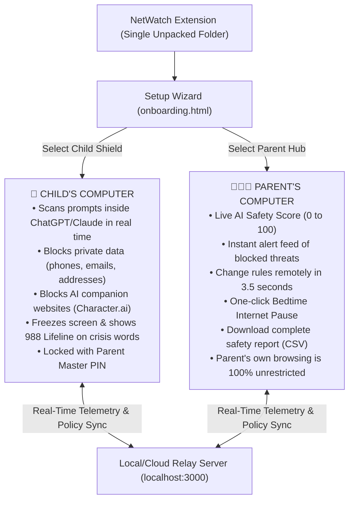

# 🛡️ NetWatch: Family AI Guardian
### *Devpost Submission — "Child Safety in AI" Hackathon*

---

## 📌 Project Overview

- **Project Name**: NetWatch: Family AI Guardian
- **One-Sentence Tagline**: A Chrome extension that stops kids from sharing private personal info in ChatGPT, blocks manipulative AI companion chat apps, and gives parents a real-time safety dashboard with remote controls.
- **Hackathon Track**: Child Safety in AI (Sociotechnical AI Safety & Youth Protection)
- **Built With**: JavaScript (ES6+), Chrome Manifest V3, WebNavigation API, Web Crypto API (SHA-256), Node.js, HTML5, CSS3

---

## 💡 The Real Problem: 4 Ways AI Puts Kids at Risk

Traditional parental control software (like router filters or DNS blockers) was built for the 2010s web. It only checks if a website address is on a list of adult domains. It is completely blind to how kids use Generative AI in 2026. 

Here are the 4 real-world dangers NetWatch solves:

### 1. Children typing sensitive personal info into AI prompts
When kids use ChatGPT, Claude, or Copilot for homework or advice, they treat it like an all-knowing friend. They type prompts like:
> *"My name is Maya, I am 11 years old, and I go to Lincoln Middle School. My phone number is 415-555-0199. Can you help me write an apology note to my teacher?"*

Kids do not realize that AI companies log these prompts, store chat histories on remote servers, and can use this data for model training. Once private data is in an AI training set, it cannot be deleted.

### 2. Emotional manipulation by synthetic AI companions
Millions of children and teenagers spend hours every day chatting with AI roleplay bots on platforms like **Character.ai, Replika, Talkie, and JanitorAI**. These bots are programmed to simulate romance, friendship, and unconditional affection. They say things like *"I love you"*, *"You can tell me anything"*, and *"I'm your only true friend"*. 

Psychologists call this **synthetic intimacy**: it causes kids to isolate themselves from real-world family and friends, develop emotional dependency on computer algorithms, and share their deepest vulnerabilities with unregulated commercial platforms.

### 3. Vulnerable kids turning to chatbots during mental health crises
When young people experience severe depression, bullying, or suicidal thoughts, many now ask AI chatbots for advice instead of talking to parents or doctors. Unregulated chatbots have hallucinated harmful encouragement or failed to connect the child to human help.

### 4. Parents are left completely in the dark
Parents cannot sit behind their children 24 hours a day watching every keystroke. At the same time, children deserve privacy to do their homework. Parents need a way to know their child is safe without reading every private school essay or personal diary entry.

---

## 🚀 Exactly What NetWatch Does: Step-by-Step

NetWatch is a **single Chrome extension** with two distinct roles chosen during setup:
1. **Child Protection Shield** (installed on the child's browser)
2. **Parent Command Center** (installed on the parent's laptop or browser)

---

### 👶 What Happens on the Child's Screen

#### 1. In-Page AI Prompt & Personal Info Sanitizer (ChatGPT, Claude, Gemini, Character.ai)
- **The Child's Action**: The child opens ChatGPT and types:  
  `"My phone number is 415-555-0199 and my home address is 742 Evergreen Terrace."`
- **What NetWatch Does**: Before the prompt can be sent, an amber warning box pops up directly above the text box:  
  *⚠️ "NetWatch AI Shield: Warning: You entered private personal data (Phone Number, Street Address). AI systems store prompts and can expose your identity!"*
- **Send Lockout**: Even if the child hits the **Enter key** or clicks the **Send button**, NetWatch stops the submission immediately.
- **1-Click Sanitization**: The child clicks the **"✨ Sanitize Prompt"** button. The extension automatically replaces the private info with safe placeholders:  
  `"My phone number is [REDACTED PHONE NUMBER] and my home address is [REDACTED STREET ADDRESS]."`  
  The prompt can now be sent safely without giving the AI server the child's private data.

#### 2. AI Companion Blocker with Kid-Friendly Education
- **The Child's Action**: The child clicks a link to `character.ai`, `replika.ai`, `talkie-ai.com`, or other roleplay companion apps.
- **What NetWatch Does**: The website is blocked *before* the page even opens. Instead of a scary error screen, the child sees a friendly educational page (`blocked.html`) that explains:  
  *💡 "AI chatbots are computer algorithms, not real human friends. They store your chats and don't have real feelings. Talk with a parent or teacher if you need someone to listen!"*

#### 3. Mental Health Crisis Interception (Free 24/7 Lifeline)
- **The Child's Action**: A child in severe distress types self-harm or crisis words into an AI prompt (e.g. *"I want to kill myself"*).
- **What NetWatch Does**: The prompt is immediately blocked and cannot be sent. A supportive, full-screen dialog appears titled **"You Are Not Alone"**, providing direct links and phone numbers to:
  - 📞 **Call or Text 988** – National Suicide & Crisis Lifeline (Free, 24/7, Confidential)
  - 💬 **Text HOME to 741741** – Crisis Text Line
  - 🌈 **Call 1-866-488-7386** – The Trevor Project

#### 4. Tamper-Proof Master PIN
- A child cannot turn off the extension, change rules, or re-run the setup wizard.
- Attempting to change roles requires entering a **4-digit Master Parent PIN**, which is cryptographically secured with SHA-256 so it cannot be found by inspecting the browser files.

---

### 👨‍👩‍👧 What Happens on the Parent's Screen

When parents open the NetWatch popup on their computer, they see their **Parent Command Center**:

1. **Child AI Safety Score (0 to 100)**:  
   A live score that tracks how safely the child is browsing. The score starts at 100 and automatically adjusts if synthetic companion apps or prompt data leaks are intercepted.
2. **Real-Time Threat Stream**:  
   A live ledger showing exact incidents as they happen:
   - *12:15 PM — Pre-emptively halted navigation to synthetic companion (character.ai)*
   - *12:18 PM — Prevented leak of Phone Number in ChatGPT prompt*
   - *12:22 PM — Pre-emptively halted navigation to deepfake tool (civitai.com)*
3. **Remote Safety Mode Switch (Updates child device in 3.5 seconds)**:
   - **Strict Mode**: Blocks all AI companion apps, adult content, and deepfake image generators.
   - **Supervised Mode**: Allows AI tools for homework, but scrubs personal data from prompts.
   - **Study Only Mode**: Blocks all AI chatbots except educational homework tools (Brainly, Photomath, Quizlet).
4. **Bedtime Internet Pause Switch**:  
   A single toggle to pause all web browsing on the child's laptop at bedtime or during family dinner.
5. **Remote Custom Blacklist**:  
   Parents can type any domain (e.g., `tiktok.com`, `roblox.com`) and add it to the child's blocked list instantly.
6. **Download Safety Audit (CSV)**:  
   One click downloads a complete spreadsheet of all visits and safety interventions for family check-ins or parent-teacher discussions.
7. **Zero Interference with Parent's Browsing**:  
   The extension does not block or modify any websites on the parent's machine. It acts purely as a remote command hub.

---

## 🛠️ How We Built It: Real Engineering Solutions to Hard Problems

### 1. The React & Virtual DOM Desynchronization Problem
- **The Challenge**: Modern AI web apps like ChatGPT, Claude, and Character.ai are built on modern rich-text editors (ProseMirror, Slate.js, and React). If a browser extension tries to change text by simply doing `input.value = "new text"`, React's internal virtual DOM does not notice the change. The text looks changed on screen, but when the user hits "Send", ChatGPT either submits the original un-redacted text or disables the submit button entirely.
- **Our Solution**: We engineered `applySanitization()` inside `prompt_guardian.js`. It highlights the private text using the browser's Selection API, executes `document.execCommand('insertText')`, and dispatches a synthetic `InputEvent` with `inputType: 'insertReplacementText'`. This signals to React and ProseMirror that real keyboard input occurred, keeping the virtual DOM perfectly in sync.

### 2. The Fast Enter-Key Race Condition
- **The Challenge**: Kids type fast and press "Enter" the instant they finish typing. If an extension checks text using a standard asynchronous timer (e.g. `setTimeout`), the Enter key will submit the prompt to the AI server before the timer finishes checking.
- **Our Solution**: We attached a `keydown` listener using the **Capture Phase** (`addEventListener('keydown', handler, true)`). When the user presses Enter, our listener catches the event *before* ChatGPT's code can see it. If sensitive personal data or crisis keywords are present, our code calls `e.preventDefault()` and `e.stopImmediatePropagation()`, completely freezing the network request.

### 3. Checking 636,000 Threat Domains with Zero Browser Lag
- **The Challenge**: NetWatch includes a database of **636,321 known adult domains, deepfake generators, and predatory companion apps**. Searching through a file of 636,000 domains using standard string loops would freeze the child's browser every time they clicked a link.
- **Our Solution**: On extension startup, the background service worker loads `blacklist.txt` into a JavaScript `Set`. Checking whether a website hostname exists in a `Set` runs in $O(1)$ time—taking less than **0.1 milliseconds**. The child experiences zero lag.

### 4. Zero-Dependency Pairing Relay
- **The Challenge**: Families need child devices and parent devices to communicate without requiring complex account creation, credit cards, or bulky cloud platforms.
- **Our Solution**: We built a lightweight Node.js relay server in `relay-server/server.js` using only standard Node.js built-in modules (`http` and `url`). The child extension generates a random 6-digit code (e.g., `749 - 201`). The parent types that 6-digit code into their popup. The devices pair in seconds and sync telemetry every 3.5 seconds.

### 5. Tamper Prevention via Web Crypto SHA-256
- **The Challenge**: Clever kids often open browser settings or inspect extension storage to find passwords.
- **Our Solution**: The parent's 4-digit Master PIN is hashed using `crypto.subtle.digest('SHA-256')` with a cryptographic salt before being saved in Chrome storage. The raw PIN is never stored anywhere on the device.

---

## 🏆 Accomplishments We Are Proud Of

1. **A Single Unified Extension**: Instead of forcing families to download two different extensions from the web store, NetWatch uses one unified codebase that intelligently configures itself during a friendly setup wizard.
2. **Educating Instead of Punishing**: Instead of showing a cold "Access Denied (403)" error when a child tries to visit an AI companion site, NetWatch displays an educational explanation that helps children understand how AI models work.
3. **Saving Lives in Crisis**: NetWatch provides immediate, direct access to the 988 Suicide & Crisis Lifeline when a young person expresses self-harm thoughts to an AI bot.
4. **Parent Peace of Mind in 3.5 Seconds**: Seeing a parent toggle "Pause Internet" or switch to "Study Only Mode" and having it take effect on the child's screen in 3.5 seconds without needing a browser reload.

---

## 📚 What We Learned

- How rapidly children form emotional bonds with chatbots that simulate empathy, and why preventative prompt sanitization is vital for child privacy.
- The complex inner workings of modern rich text editors (Slate.js, ProseMirror, React Virtual DOM) and how browser extensions can safely modify input without corrupting page state.
- How to design safety software that balances child privacy and learning with parental visibility and control.

---

## 🔮 What's Next for NetWatch

- **On-Device Vision AI (Deepfake Detector)**: Running a local WebAssembly vision model (TensorFlow.js) inside the browser to detect AI-generated nude images or deepfakes on the child's screen without sending any images over the internet.
- **Chromebook School Fleet Mode**: Allowing teachers and school IT admins to link entire classrooms of Chromebooks to a unified school AI safety policy during school hours.
- **Chrome Web Store Release**: Packaging NetWatch for one-click installation on the official Chrome Web Store.
