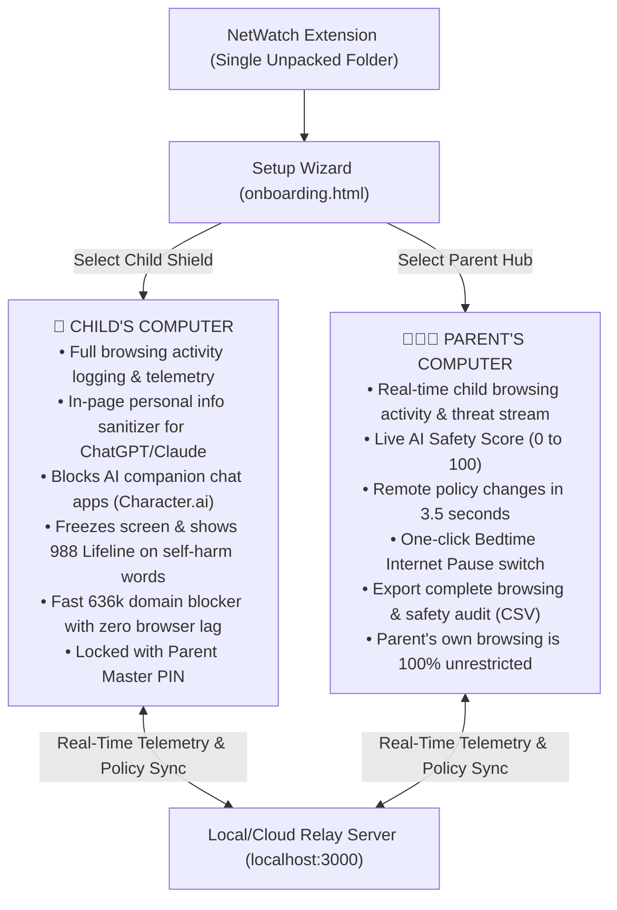

# 🛡️ NetWatch: Family Safety Guardian & Parental Command Center
### *Devpost Submission — "Child Safety in AI" Hackathon*

---

## 📌 Project Overview

- **Project Name**: NetWatch: Family Safety Guardian & Parental Command Center
- **One-Sentence Tagline**: A comprehensive parental command center that helps parents track their children's online browsing activity, enforce web curfews, and protect private personal info inside modern AI prompts.
- **Hackathon Track**: Child Safety in AI (Sociotechnical AI Safety & Youth Protection)
- **Built With**: JavaScript (ES6+), Chrome Manifest V3, WebNavigation API, Web Crypto API (SHA-256), Node.js, HTML5, CSS3

---

## 💡 The Problem: Modern Web Monitoring + The New AI Blindspot

Parenting in the digital age has become increasingly complex. Parents face two major challenges when their children go online:

### 1. The Challenge of Tracking General Online Activity
Children spend hours on laptops and Chromebooks for school, entertainment, and socializing. Parents struggle with:
- **No visibility into browsing activity**: Parents rarely know what websites their children are visiting throughout the day unless they physically look over their shoulder.
- **Screen time & late-night browsing**: Kids often browse the web late into the night when they should be sleeping, or get distracted by games and social media during homework hours.
- **Accidental exposure to harmful websites**: The web is full of millions of adult websites, unmoderated forums, and malicious platforms that children stumble upon.
- **Outdated parental controls**: Traditional parental control tools are either invasive keyloggers that take creepy screenshots, or clumsy DNS blockers that break normal school websites and are easily bypassed by kids.

### 2. The New Blindspot: What Happens Inside AI Tools
On top of regular web browsing, millions of children now use Generative AI tools (like ChatGPT, Claude, and Gemini) and AI chat apps (like Character.ai and Replika). This introduces dangers that **no traditional parental control can see**:
- **Kids leaking personal info into AI prompts**: Children treat ChatGPT like an all-knowing friend, routinely typing their real names, school names, home addresses, and phone numbers into chat prompts. AI platforms store these prompts on remote servers and may use them for model training.
- **Manipulative AI companion bots**: Platforms like Character.ai and Talkie let kids chat with AI roleplay bots programmed to simulate romance and friendship. These bots say *"I love you"* and *"I'm your only real friend"*, causing kids to isolate themselves from real family and friends.
- **Crisis situations in chat prompts**: Vulnerable children experiencing depression or self-harm often type crisis thoughts into chatbots instead of seeking human help. Unregulated bots can give dangerous advice or fail to provide emergency resources.
- **URL blockers are completely blind to prompts**: Legacy parental software only checks the domain name (`chatgpt.com`). It has **zero capability** to inspect what a child types *inside* the prompt box.

**NetWatch was built to solve both challenges in one unified system**: it gives parents complete visibility and control over their children's general online activity, while featuring an intelligent **In-Page AI Prompt & Personal Info Protector** to keep children safe in the age of AI.

---

## 🚀 Exactly What NetWatch Does: Two Core Pillars

NetWatch is a **single, unified Chrome extension** that configures itself during a friendly setup wizard into two distinct roles:
1. **Child Protection Shield** (installed on the child's browser)
2. **Parent Command Center** (installed on the parent's laptop or browser)

---

### 🛡️ PILLAR 1: Parental Online Activity Tracking & Remote Controls

NetWatch provides parents with an executive command center to manage their family's digital safety with zero disruption to the parent's own web browsing:

#### 1. Real-Time Browsing Activity & Threat Stream
Every website the child navigates to is logged and synced to the parent's dashboard in real time. Parents can see:
- Visited websites with exact timestamps.
- Flagged threats and blocked attempts (e.g., adult sites, unapproved apps, AI companion sites).
- What safety rules intervened and when.

#### 2. Live Child AI & Digital Safety Score (0 to 100)
A dynamic safety index displayed prominently in the Parent Command Center. The score begins at 100 and automatically adjusts if the child encounters risky platforms, leaks personal data, or accesses flagged content. Parents can instantly assess their child's digital safety at a single glance.

#### 3. Remote Safety Mode Dispatch (Updates in 3.5 Seconds)
Parents can remotely change rules from their own computer without touching the child's laptop:
- **Strict Mode**: Blocks all AI companion apps, adult content, and deepfake photo tools.
- **Supervised Mode**: Allows AI tools for homework, but scrubs personal data from prompts.
- **Study Only Mode**: Blocks all social media and AI chatbots except educational school tools (Brainly, Photomath, Quizlet).

#### 4. One-Click Bedtime / Focus Internet Pause
During dinner, homework hours, or bedtime, parents can toggle **"Pause Child's Internet"**. Within 3.5 seconds, all active web browsing on the child's device is paused with a calm bedtime screen until the parent resumes access.

#### 5. Remote Custom Blacklist with Instant Tags
Parents can type any specific website (e.g., `roblox.com`, `tiktok.com`, `discord.com`) into their popup and click **Add**. The custom domain is instantly added to the child's blocklist.

#### 6. Complete Downloadable Safety Audit (CSV Export)
Parents can click **"Download Child Safety Audit (CSV)"** to instantly export a complete, timestamped spreadsheet showing every website visited, every threat blocked, and every prompt sanitized. This provides objective data for family check-ins and parent-teacher meetings.

#### 7. Tamper-Proof 4-Digit Master PIN
Children cannot disable the extension, re-run setup, or switch to Parent mode. Doing so requires entering the parent's secret 4-digit Master PIN, which is cryptographically secured with salted SHA-256 encryption.

---

### 🤖 PILLAR 2: The Breakthrough In-Page AI & Personal Info Shield

While NetWatch tracks general browsing and enforces family web rules, its flagship innovation is **in-page prompt intelligence** that protects kids inside modern generative AI apps:

#### 1. In-Page Personal Info Sanitizer (ChatGPT, Claude, Gemini, Character.ai)
- **What Happens**: If a child types a phone number, home address, email, or sensitive card number into an AI chat box, an amber NetWatch alert appears directly above the prompt box:  
  *⚠️ "NetWatch AI Shield: Warning: You entered private personal data (Phone Number, Street Address). AI systems store prompts and can expose your identity!"*
- **Synchronous Send Lockout**: NetWatch catches Enter-key presses and Send-button clicks before the AI web app can dispatch the network request.
- **1-Click "✨ Sanitize Prompt"**: With a single click, NetWatch automatically replaces the sensitive info with safe redactions:  
  `"My phone number is [REDACTED PHONE NUMBER] and my address is [REDACTED STREET ADDRESS]."`  
  The child can then send their prompt safely without leaking family privacy to AI company servers.

#### 2. AI Companion Bot Neutralization with Educational Guidance
- **What Happens**: When a child tries to open addictive roleplay companion sites like `character.ai`, `replika.ai`, or `talkie-ai.com`, NetWatch blocks access before the page opens.
- **Educational Block Page**: Instead of a punitive error code, the child sees a friendly educational screen (`blocked.html`) explaining:  
  *💡 "AI chatbots are computer algorithms, not real human friends. They store your chats and don't have real feelings. Talk with a parent or teacher if you need someone to listen!"*

#### 3. Mental Health Crisis Interception (Free 24/7 Lifeline)
- **What Happens**: If a child in severe distress enters self-harm or crisis keywords into an AI prompt (e.g. *"I want to kill myself"*), NetWatch halts prompt submission immediately.
- **Immediate Support Overlay**: A supportive window appears titled **"You Are Not Alone"**, offering direct, clickable access to:
  - 📞 **Call or Text 988** – Suicide & Crisis Lifeline (Free, 24/7, Confidential)
  - 💬 **Text HOME to 741741** – Crisis Text Line
  - 🌈 **Call 1-866-488-7386** – The Trevor Project

#### 4. High-Speed 636,000+ Domain Blocker
NetWatch includes an in-memory database of over **636,321 known adult, predatory, and deepfake domains**, evaluating navigation in under **0.1 milliseconds** with zero browser lag.

---

## 🛠️ How We Built It: Real Engineering Solutions

1. **Browsing Telemetry & Pairing Engine**:
   - Built a lightweight, zero-dependency Node.js relay server in `relay-server/server.js` using native `http` and `url` modules.
   - Child extensions generate an ephemeral 6-digit pairing code (e.g., `749 - 201`).
   - Telemetry batches of visited URLs, safety events, and stats are pushed every 3.5 seconds and stored in an audit buffer for parental review.

2. **React / ProseMirror Virtual DOM Synchronization**:
   - Modern AI interfaces (ChatGPT, Claude) use rich-text frameworks (Slate.js, ProseMirror, React). Modifying `input.value` directly causes React state desynchronization.
   - We engineered `applySanitization()` in `prompt_guardian.js` using `document.execCommand('insertText')` combined with synthetic `InputEvent` dispatching (`insertReplacementText`). This ensures ChatGPT's internal state updates cleanly and the send button remains fully functional.

3. **Synchronous Enter-Key Interception**:
   - To stop fast typers from hitting Enter before debounce timers complete, we attached a `keydown` listener in the **DOM Capture Phase** (`true`). The keypress is evaluated synchronously and stopped via `e.preventDefault()` and `e.stopImmediatePropagation()` before the host webpage can process it.

4. **In-Memory Set for 636,000 Domains**:
   - Loading `blacklist.txt` into an in-memory JavaScript `Set` allows $O(1)$ lookup time (less than 0.1ms), ensuring zero performance penalty on the child's browsing experience.

5. **Salted SHA-256 Web Crypto PIN**:
   - The 4-digit Master Parent PIN is salted and hashed client-side using `crypto.subtle.digest('SHA-256')`, ensuring the raw password cannot be found by inspecting browser storage or dev tools.

---

## 🏆 Accomplishments We Are Proud Of

1. **A Complete, Dual-Faceted Guardian**: Bridging everyday parental activity monitoring (browsing history, curfews, domain blocks) with cutting-edge AI prompt privacy in a single, unified extension.
2. **Instant Remote Sync in 3.5 Seconds**: Watching a parent toggle "Pause Internet" or switch to "Study Only Mode" on their laptop and seeing it enforce on the child's screen within 3.5 seconds without a page refresh.
3. **Compassionate Crisis Protection**: Providing direct, life-saving human support resources when a child expresses distress to an AI chatbot.
4. **Zero-Lag, Lightweight Architecture**: Zero external npm dependencies in the relay server and sub-millisecond threat lookups in the browser.

---

## 📚 What We Learned

- How modern families need tools that combine broad online activity tracking with specific AI safeguards.
- The inner workings of modern web rich text frameworks and how browser extensions can safely modify input without desynchronizing Virtual DOM states.
- How to design safety software that gives parents peace of mind while preserving child dignity and encouraging open family communication.

---

## 🔮 What's Next for NetWatch

- **On-Device Vision AI (Deepfake & Image Shield)**: Local WebAssembly vision models (TensorFlow.js) to detect AI-generated explicit media directly in the browser without cloud processing.
- **School & Chromebook Fleet Management**: Multi-device management allowing schools to enforce study-mode policies across classroom Chromebook fleets during school hours.
- **Chrome Web Store Release**: Publishing NetWatch for one-click installation by families worldwide.
