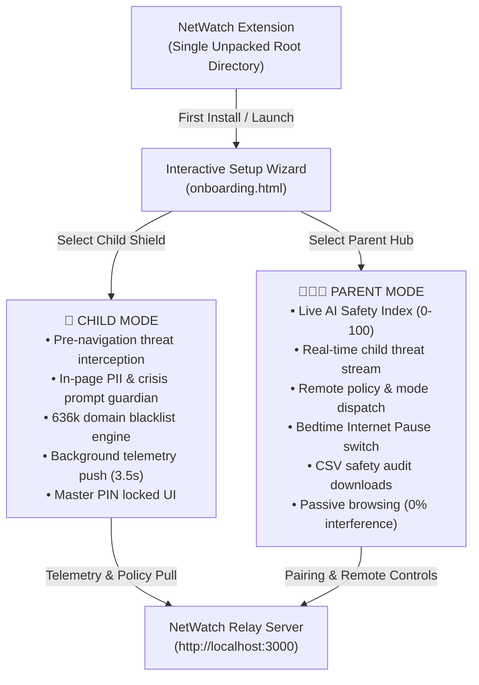

# 🛡️ NetWatch: Unified Family AI Guardian

*A unified, role-adaptive Chrome extension and parental command center designed to protect children in the age of AI, synthetic companions, deepfakes, and prompt PII harvesting.*

---

## 🌟 The Single-Extension Architecture

Rather than maintaining separate extensions, **NetWatch is a single, unified extension** that dynamically adapts its behavior, UI, and security controls based on the role selected during the **Onboarding Wizard**:



---

## 🔒 Master PIN Role Protection

Children cannot bypass restrictions by re-running the setup wizard or switching roles:
- The parent configures a **4-digit Master Parent PIN** during onboarding.
- The PIN is salted and hashed using **SHA-256 (`crypto.subtle`)**.
- Any attempt to switch the role or re-launch the setup wizard via the popup requires entering the valid Master PIN.

---

## 📁 Repository Structure

```text
NetWatch/
├── manifest.json        # Manifest V3 unified configuration
├── background.js        # Role-adaptive service worker (Child engine vs. Parent hub)
├── prompt_guardian.js   # Content script: PII & crisis sentinel (only active in Child mode)
├── popup.html / js / css# Dynamic popup view (Unconfigured / Child Shield / Parent Hub)
├── onboarding.html / js # Interactive multi-step setup wizard & role selector
├── blocked.html         # Kid-friendly educational access-paused page
├── blacklist.txt        # 636,321 curated threat, companion, and proxy domains
├── images/              # Extension icons (16px, 24px, 32px, 48px, 128px)
│
└── relay-server/        # Zero-dependency local/cloud synchronization server
    ├── server.js        # Node.js pairing, telemetry ingestion & policy relay
    └── package.json     # Package configuration
```

---

## 🚀 Quickstart: Setting Up Child & Parent Devices

### 1. Start the Relay Server
Open a terminal in the `relay-server/` directory and run:

```bash
cd "d:\Hackathon Projects\NetWatch\relay-server"
node server.js
```
*The relay server runs on `http://localhost:3000`.*

---

### 2. Configure the Child Device (Browser A)
1. Open the **Child's Browser** (or Chrome Profile A / Chromebook).
2. Navigate to `chrome://extensions/` and enable **Developer mode**.
3. Click **Load unpacked** and select the root project folder:
   `d:\Hackathon Projects\NetWatch`
4. **Onboarding Launches Automatically**:
   - Choose **"👶 Child's Device (Protection Shield)"**.
   - Note the **6-digit Family Pairing Code** displayed on screen (e.g. `749 - 201`).
   - Review the 3 safe AI browsing rules and click **Finish**.
5. The extension is now actively protecting browsing and LLM prompts.

---

### 3. Configure the Parent Device (Browser B)
1. Open the **Parent's Browser** (or Chrome Profile B / Microsoft Edge / separate computer).
2. Navigate to `chrome://extensions/` and enable **Developer mode**.
3. Click **Load unpacked** and select the *same* root project folder:
   `d:\Hackathon Projects\NetWatch`
4. **Setup Wizard Launches Automatically**:
   - Choose **"👨‍👩‍👧 Parent / Guardian (Command Center)"**.
   - **Create Master PIN**: Enter a 4-digit PIN (e.g. `1234`) to secure role changes and administrative settings.
   - **Link Child Device**: Enter the child's 6-digit pairing code from Step 2.
   - **Select Initial Policy**: Choose **Strict Mode**, **Supervised AI Mode**, or **Study Only Mode**, and optionally check quick-block tags (*Roblox, TikTok, Discord*).
   - Click **Finish & Launch Command Center**.
5. The parent extension is now monitoring the child's telemetry in real-time with zero interference on the parent's own browsing tabs.

---

## ⚡ Live Features Across Devices

| Feature | Child's Experience | Parent's Experience |
| :--- | :--- | :--- |
| **AI Companion Protection** | Attempts to visit Character.ai, Replika, Crushon, JanitorAI redirect instantly to `blocked.html` explaining synthetic risks. | Alert logged immediately in live feed: `🤖 Companion: Pre-emptively halted navigation to character.ai`. |
| **In-Page PII Leak Shield** | Typing phone numbers, email addresses, or physical addresses in ChatGPT / Claude triggers an in-page toast with a 1-click **Sanitize Prompt** button. | Metrics counter increments and alert appears in live dashboard: `🔒 PII Shield: Prevented leak of Phone Number`. |
| **Mental Health Crisis Shield** | Typing self-harm or crisis keywords immediately halts submission and displays the National 988 Suicide & Crisis Lifeline dialog. | High-priority intervention alert appears in parent stream: `🆘 Crisis: Crisis keywords intercepted; crisis lifeline displayed`. |
| **Remote Safety Mode Switch** | Policy updates apply automatically within 3.5 seconds. | Select **Strict**, **Supervised**, or **Study Only** from dropdown and click **Push Policy Update**. |
| **Bedtime / Focus Internet Pause** | All web navigation is temporarily paused with a bedtime notice. | Toggle **⏸️ Pause Child's Internet** and push update. |
| **Remote Custom Blacklist** | Custom domains entered by parent are blocked immediately. | Add domains like `tiktok.com, roblox.com` in popup and click **Push Policy Update**. |
| **Safety Audit CSV Export** | No interruption to child. | Click **Download Child Safety Audit (CSV)** to download a complete timestamped log of all incidents and visited sites. |
| **Tamper Prevention** | Child cannot disable the shield or switch role without the 4-digit Master Parent PIN. | Parent can switch roles or re-run setup anytime using their PIN. |

---

## 🛡️ Modern Web & Security Standards
- **Manifest V3 Compliant**: Built using modern `webNavigation.onBeforeNavigate` for pre-navigation threat interception.
- **V-DOM Desynchronization Immune**: `prompt_guardian.js` uses `document.execCommand('insertText')` and synthetic input events to ensure React, Slate, and ProseMirror virtual DOM states remain perfectly in sync.
- **Zero Heavy Dependencies**: Extension runs natively on vanilla JavaScript; relay server runs on native Node.js HTTP/URL modules with zero npm bloat.
