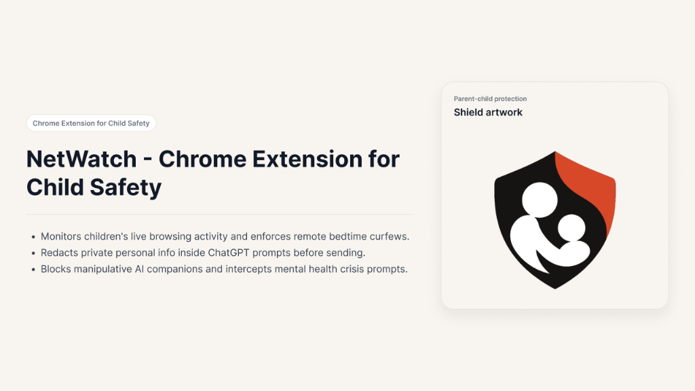
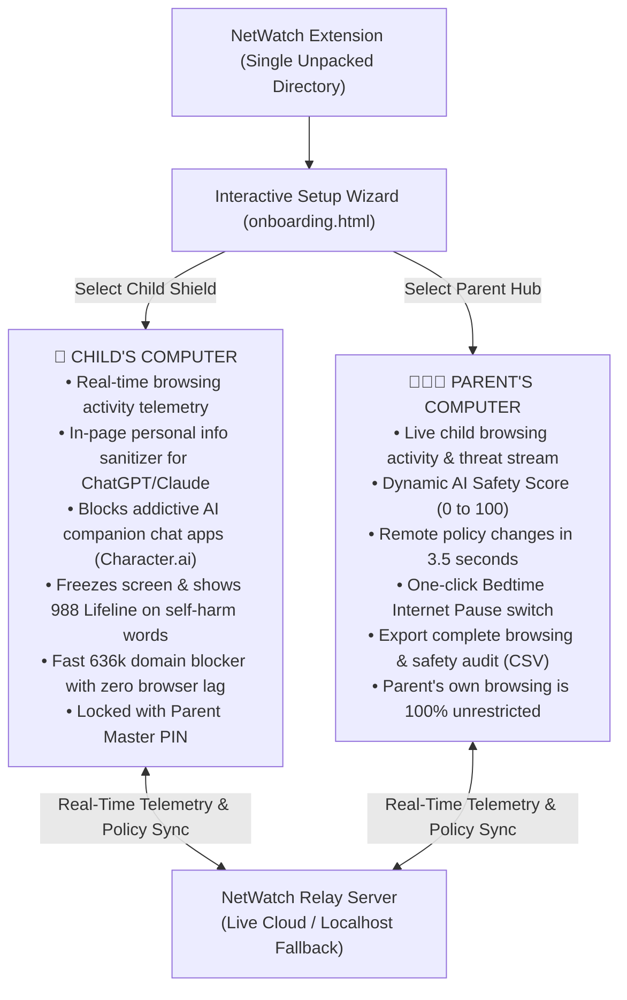
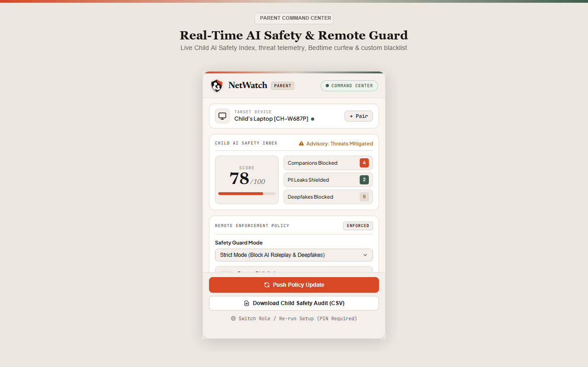
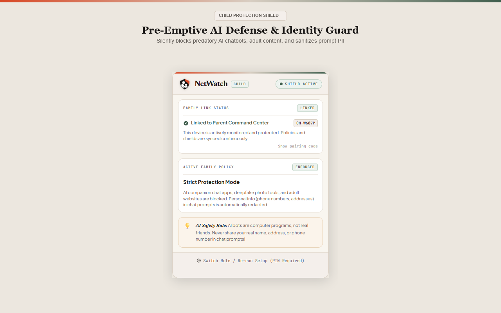
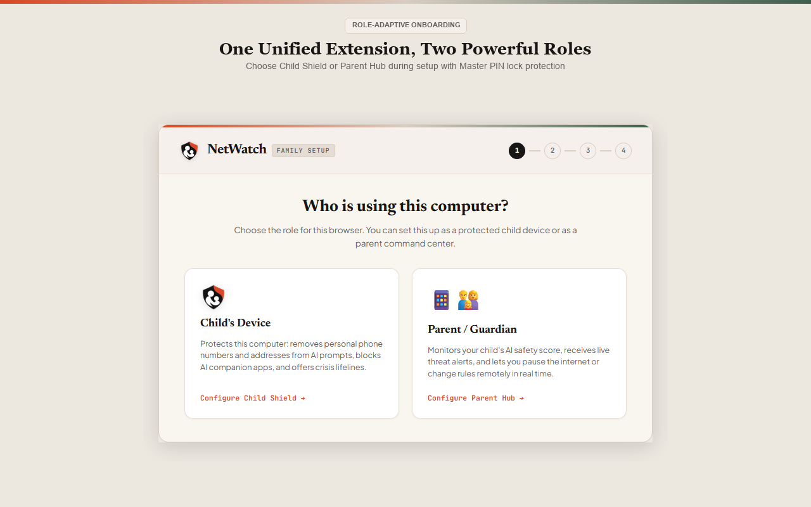
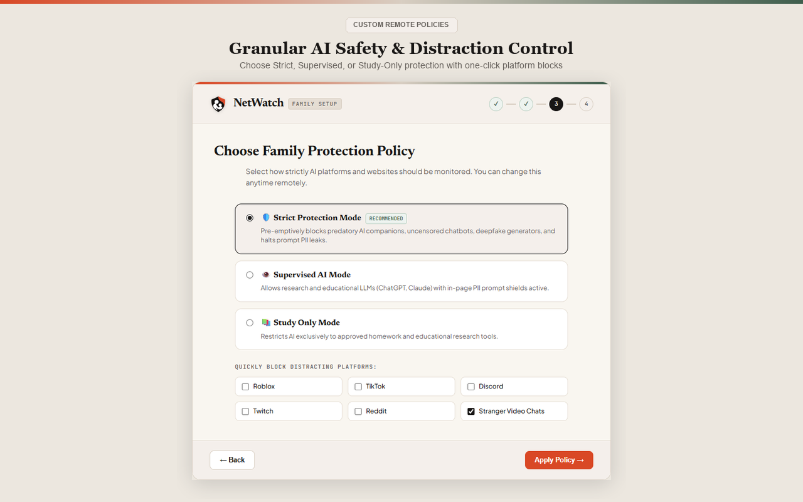
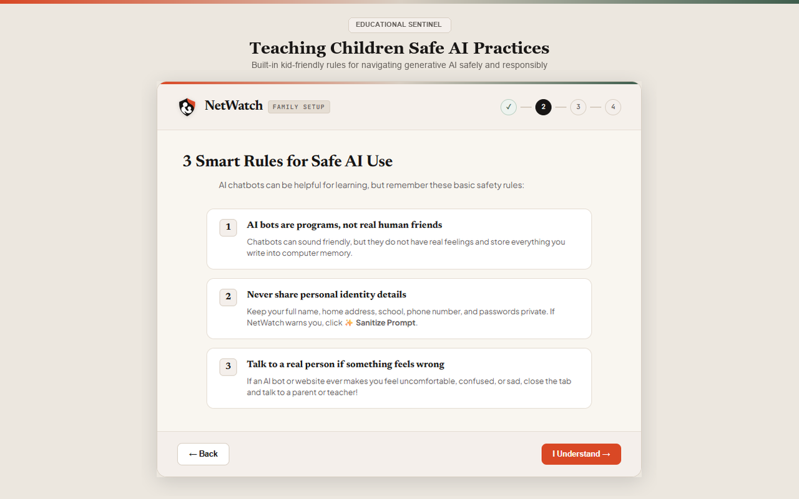
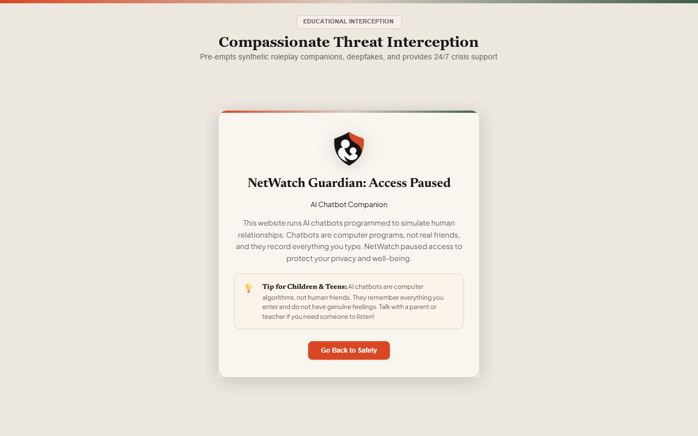

<p align="center">
  
</p>

# NetWatch - Chrome Extension for Child Safety

<p align="center">
  <a href="https://devpost.com/software/netwatch-chrome-extension-for-child-safety"></a>
  
  
  
</p>

> **Devpost Project**: [https://devpost.com/software/netwatch-chrome-extension-for-child-safety](https://devpost.com/software/netwatch-chrome-extension-for-child-safety)  
> **One-Sentence Tagline**: *A complete family safety guardian and parental command center that helps parents monitor their children's online browsing activity, enforce digital curfews, block harmful sites, and protect private personal information inside AI prompts.*

---

## 💡 The Problem: Modern Web Monitoring + The New AI Blindspot

Parenting in the digital age involves two distinct challenges:

1. **Tracking General Online Activity**: Children spend hours daily on laptops and Chromebooks. Parents have zero visibility into browsing histories without physically looking over their shoulders, struggle to enforce curfews against late-night browsing, and worry about accidental exposure to adult websites. Traditional parental control software consists of invasive keyloggers or rigid DNS filters that break school websites and cause constant friction.
2. **The New AI Blindspot**: Millions of children now use Generative AI tools (ChatGPT, Claude, Gemini) and AI roleplay companions (Character.ai, Replika). Children routinely share private details—home addresses, phone numbers, and school names—into AI prompt boxes that store chats indefinitely. Furthermore, manipulative roleplay chatbots simulate romance and friendship, while vulnerable kids experiencing mental health crises type distress thoughts to bots instead of seeking human help. **Traditional URL blockers only check domain names (`chatgpt.com`) and are 100% blind to what is typed inside the prompt box.**

**NetWatch was built to solve both challenges in one unified system.**

---

## 🚀 Two Core Pillars



---

### 🛡️ PILLAR 1: Parental Online Activity Monitoring & Remote Controls
NetWatch gives parents an executive command center to manage their family's digital safety with zero disruption to the parent's own web browsing:

- 📡 **Real-Time Browsing Activity & Threat Stream**: Every website visited by the child is logged and synced to the parent's dashboard with exact timestamps, flagged categories, and intervention notes.
- 🎯 **Live Child AI & Digital Safety Score (0 to 100)**: A dynamic safety index that calculates digital well-being in real time, adjusting when threats are blocked or personal data is intercepted.
- ⚡ **Remote Safety Mode Dispatch (3.5-Second Sync)**:
  - **Strict Mode**: Blocks all AI companion apps, adult websites, and deepfake photo tools.
  - **Supervised Mode**: Allows generative AI for homework while actively scrubbing personal info from prompts.
  - **Study Only Mode**: Restricts browsing exclusively to verified school and educational tools (Brainly, Quizlet, Photomath).
- ⏸️ **One-Click Bedtime / Focus Internet Pause**: Instantly pauses all active web browsing on the child's laptop during dinner or bedtime with a calm, non-punitive focus screen.
- 🏷️ **Remote Custom Blacklist**: Add custom domain blocks (`roblox.com`, `tiktok.com`, `discord.com`) from the parent popup with instant chip tags.
- 📊 **Downloadable Safety Audit (CSV Export)**: Export a complete, timestamped spreadsheet of all visited sites, intercepted threats, and sanitized prompts for family check-ins.
- 🔐 **Tamper-Proof Master PIN**: Protected by salted **SHA-256 (`crypto.subtle`)** encryption. Children cannot disable the shield, re-run setup, or switch roles without the parent's 4-digit PIN.

---

### 🤖 PILLAR 2: Breakthrough In-Page AI & Personal Info Shield
While NetWatch monitors general browsing, its flagship innovation is **in-page prompt intelligence** active across ChatGPT, Claude, Gemini, and AI chat apps:

- 🔒 **In-Page Personal Info Sanitizer**: Scans for phone numbers, home/street addresses, email addresses, and payment card numbers as the user types.
- 🛑 **Synchronous Send Lockout**: Intercepts `Enter`-key presses and `Send`-button clicks in the DOM capture phase, preventing transmission before the prompt leaves the browser.
- ✨ **1-Click "Sanitize Prompt"**: Automatically transforms prompts into safe versions without breaking ChatGPT's internal ProseMirror virtual DOM:
  > *Before*: `"Can you help me with homework? My phone is 415-555-0199 and I live at 742 Evergreen Terrace."*  
  > *After*: `"Can you help me with homework? My phone is [REDACTED PHONE NUMBER] and I live at [REDACTED STREET ADDRESS]."`
- 🤖 **AI Companion Bot Neutralization**: Pre-emptively halts navigation to manipulative roleplay bots (Character.ai, Replika, Talkie, Crushon) and displays an educational guidance screen explaining that AI bots are algorithms, not real friends.
- 💙 **Mental Health Crisis Interception**: Halts prompt submission immediately if self-harm or crisis keywords are detected, presenting an emergency modal with direct 24/7 access to the **988 Suicide & Crisis Lifeline**, **Crisis Text Line (HOME to 741741)**, and **The Trevor Project**.
- ⚡ **High-Speed 636,000+ Domain Blocker**: High-speed in-memory database evaluating 636,321 known threat and adult domains in under **0.1 milliseconds**.

---

## 📸 Product Interface & Listing Posters

<p align="center">
  
  
</p>
<p align="center">
  
  
</p>
<p align="center">
  
  
</p>

---

## 📁 Repository Structure

```text
NetWatch/
├── manifest.json        # Manifest V3 unified extension configuration
├── background.js        # Role-adaptive service worker (Child engine vs. Parent hub)
├── prompt_guardian.js   # Content script: PII & crisis prompt interception
├── popup.html / js / css# Dynamic Swiss Editorial popup (Child Shield / Parent Hub)
├── onboarding.html / js # Interactive multi-step setup wizard & role selector
├── blocked.html / js    # Kid-friendly educational access-paused page
├── test_ai_shield.html  # Interactive in-browser ChatGPT simulation testbed
├── blacklist.txt        # 636,321 curated threat, companion, and proxy domains
├── images/              # Extension icons (16px, 24px, 32px, 48px, 128px) & banner
├── store_posters/       # Official 1280x800 Chrome Web Store listing posters
├── store_screens/       # Clean pixel-perfect extracted application views
│
└── relay-server/        # Zero-dependency local/cloud synchronization server
    ├── server.js        # Node.js pairing, telemetry ingestion & policy relay
    └── package.json     # Package configuration
```

---

## 🚀 Quickstart: Setting Up Child & Parent Devices

### 1. Relay Server (Live Cloud or Local)
NetWatch features a resilient **dual-endpoint failover architecture**:
- 🌐 **Primary Live Cloud Relay**: [`https://netwatch-w7c2.onrender.com`](https://netwatch-w7c2.onrender.com) *(Hosted live on Render, zero setup required! Ready out of the box).*
- 💻 **Automatic Localhost Fallback**: The extension automatically falls back to `http://localhost:3000` with zero configuration needed if working offline or during cloud cold starts.
- 🔄 **Running the Local Relay (Optional)**:
  ```bash
  git clone https://github.com/rohityin/NetWatch.git
  cd NetWatch/relay-server
  node server.js
  ```
  *The relay server uses zero npm dependencies and persists state across restarts in `registry.json`.*

> 🧪 **Interactive Web Demo**: Visit [`https://netwatch-w7c2.onrender.com/demo`](https://netwatch-w7c2.onrender.com/demo) (or `http://localhost:3000/demo` locally) in any browser to test in-page prompt sanitization and crisis interception in an interactive ChatGPT simulation!

---

### 2. Configure the Child Device (Browser A)
1. Open the **Child's Browser** (or Chrome Profile A / Chromebook).
2. Navigate to `chrome://extensions/` and enable **Developer mode** (top-right toggle).
3. Click **Load unpacked** and select the cloned root `NetWatch/` directory.
4. **Setup Wizard Launches Automatically**:
   - Choose **"👶 Child's Device (Protection Shield)"**.
   - Note the **6-digit Family Pairing Code** displayed on screen (e.g. `749 - 201`).
   - Review the 3 safe AI browsing rules and click **Finish**.
5. The extension is now actively protecting browsing and LLM prompts.  
   *(💡 Tip: Refresh any already-open ChatGPT or Claude tabs so Chrome attaches the guardian script).*

---

### 3. Configure the Parent Device (Browser B)
1. Open the **Parent's Browser** (or Chrome Profile B / Microsoft Edge / separate computer).
2. Navigate to `chrome://extensions/` and enable **Developer mode**.
3. Click **Load unpacked** and select the *same* root `NetWatch/` directory.
4. **Setup Wizard Launches Automatically**:
   - Choose **"👨‍👩‍👧 Parent / Guardian (Command Center)"**.
   - **Create Master PIN**: Enter a 4-digit PIN (e.g. `1234`) to secure role changes and administrative settings.
   - **Link Child Device**: Enter the child's 6-digit pairing code from Step 2.
   - **Select Initial Policy**: Choose **Strict Mode**, **Supervised AI Mode**, or **Study Only Mode**, and optionally check quick-block tags (*Roblox, TikTok, Discord*).
   - Click **Finish & Launch Command Center**.
5. The parent extension is now monitoring the child's telemetry in real time with zero interference on the parent's own browsing tabs.

---

## ⚡ Live Features Across Devices

| Feature | Child's Experience | Parent's Experience |
| :--- | :--- | :--- |
| **AI Companion Protection** | Attempts to visit Character.ai, Replika, Crushon, JanitorAI redirect instantly to `blocked.html` explaining synthetic risks. | Alert logged immediately in live feed: `🤖 Companion: Pre-emptively halted navigation to character.ai`. |
| **In-Page PII Leak Shield** | Typing phone numbers, email addresses, or physical addresses in ChatGPT / Claude triggers an in-page toast with a 1-click **Sanitize Prompt** button. | Metrics counter increments and alert appears in live dashboard: `🔒 PII Shield: Prevented leak of Phone Number`. |
| **Mental Health Crisis Shield** | Typing self-harm or crisis keywords immediately halts submission and displays the National 988 Suicide & Crisis Lifeline dialog. | High-priority intervention alert appears in parent stream: `🆘 Crisis: Crisis keywords intercepted; crisis lifeline displayed`. |
| **Remote Safety Mode Switch** | Policy updates apply automatically within 3.5 seconds. | Select **Strict**, **Supervised**, or **Study Only** from dropdown and click **Push Policy Update**. |
| **Bedtime / Focus Internet Pause** | All web navigation is temporarily paused with a bedtime notice. | Toggle **⏸️ Pause Child's Internet** and push update. |
| **Remote Custom Blacklist** | Custom domains entered by parent are blocked immediately. | Add domains like `tiktok.com, roblox.com` in popup and click **Push Policy Update**. |
| **Safety Audit CSV Export** | No interruption to child. | Click **Download Child Safety Audit (CSV)** to download a complete timestamped log of all incidents and visited sites. |
| **Tamper Prevention** | Child cannot disable the shield or switch role without the 4-digit Master Parent PIN. | Parent can switch roles or re-run setup anytime using their PIN. |

---

## 🛡️ Technical Architecture & Modern Standards

- **Manifest V3 Compliant**: Uses modern service worker architecture and `webNavigation.onBeforeNavigate` for pre-navigation interception without background tab polling.
- **ProseMirror / React V-DOM Desync Immune**: `prompt_guardian.js` uses `document.execCommand('insertText')` combined with synthetic `InputEvent` dispatching (`insertReplacementText`) so ChatGPT's internal state updates cleanly.
- **Zero-Bypass Capture Phase**: Synchronously intercepts `Enter`-key keydown events and `Send`-button clicks before page scripts execute.
- **Zero Heavy Dependencies**: Extension is built on 100% vanilla ES6+ JavaScript; relay server uses native Node.js HTTP/URL modules with zero npm packages.
- **Privacy First**: Prompt scanning occurs entirely on-device inside the child's browser. Raw prompt text is never uploaded to remote servers.
